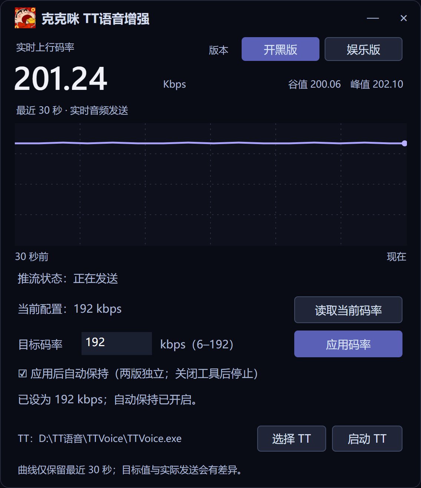

# 克克咪 · TT 语音增强

分别调节 TT 开黑版和娱乐版的上行码率及单／双声道，支持 6–192 kbps、码率自动保持和最近 30 秒的实时曲线。

**[下载 Windows 版](https://github.com/kkray983681062-bit/kekemi-tt-voice-enhancer/releases/latest)**

码率界面示意，图中数值为演示值；新版另有“设为单声道”“设为双声道”按钮。

## 使用

1. 打开 TT，进入房间并上麦，在工具中选择对应版本。
2. 点击“读取当前配置”，输入目标值后点击“应用码率”。
3. 需要保留伴奏、混响的左右效果时，点击“设为双声道”；普通单麦克风人声也可保持单声道。切换声道会保留当前码率。
4. 勾选自动保持可持续保持码率；两版同时运行时可分别设置。声道目前需手动切换。

工具会记住两版安装位置，找不到时可手动选择，也可启动 TT。关闭工具只停止保持，**不会自动恢复原码率或声道**；请先记下原值。

本机已验证两版的 192 kbps＋双声道，实际编码器均使用 48 kHz；本工具未修改采样率。对端立体声接收与听感仍需试听确认。

需要 64 位 Windows；仅支持已适配的 TT 引擎。配置目标和实际发送值可能不同，更新客户端后可能需要重新适配。

[兼容版本、详细用法与编译](docs/guide.md) · [声道与采样率测试记录](docs/stereo-test.md) · [问题反馈](https://github.com/kkray983681062-bit/kekemi-tt-voice-enhancer/issues)
